# Object-Oriented Airlines - UML Class Diagram

This Mermaid diagram represents the complete class structure of the ObjectOrientedAirlines system.

```mermaid
classDiagram
    %% ==================== INTERFACES ====================
    class Notifiable {
        <<interface>>
        +notify(String message)
        +notifyWithPrefix(String prefix, String message)
    }

    %% ==================== ABSTRACT CLASSES ====================
    class Reservation {
        <<abstract>>
        -String reservationId
        -Instant createdAt
        -ReservationStatus status
        +Reservation(String reservationId)
        +Reservation(String reservationId, Instant createdAt, ReservationStatus status)
        +getReservationId() String
        +getCreatedAt() Instant
        +getStatus() ReservationStatus
        +confirm() void
        +isActive() boolean
        +cancel(Instant cancelTime)* void
        +computePenalty(Instant cancelTime) double
        #markCanceled() void
        #onStatusChanged(ReservationStatus newStatus) void
        #ensureStatus(ReservationStatus expected, String message) void
        +equals(Object o) boolean
    }

    class Crew {
        <<abstract>>
        -String employeeId
        -String fullName
        -LocalDate hiredOn
        -CrewStatus status
        -String baseAirport
        #Crew(String employeeId, String fullName, LocalDate hiredOn, String baseAirport)
        +getEmployeeId() String
        +getFullName() String
        +getHiredOn() LocalDate
        +getStatus() CrewStatus
        +setStatus(CrewStatus status) void
        +getBaseAirport() String
        +setBaseAirport(String baseAirport) void
        +getRole()* Role
        +canOperate(PlaneType type)* boolean
        +equals(Object obj) boolean
    }

    %% ==================== ENUMS ====================
    class CrewStatus {
        <<enumeration>>
        AVAILABLE
        ON_LEAVE
        SUSPENDED
    }

    class FAPosition {
        <<enumeration>>
        LEAD
        JUNIOR
    }

    class PilotRank {
        <<enumeration>>
        CAPTAIN
        FIRST_OFFICER
    }

    class PlaneType {
        <<enumeration>>
        E175
        A320
        A321
        B737
        B787
        A350
        B777
        -String manufacturer
        -String modelLabel
        -int rangeNm
        -int typicalSeats
        -boolean widebody
        -int defaultSeatsPerRow
        -String defaultSeatLetters
        +supportsRouteNm(int distanceNm) boolean
        +getManufacturer() String
        +getModelLabel() String
        +getRangeNm() int
        +getTypicalSeats() int
        +isWidebody() boolean
        +getDefaultSeatsPerRow() int
        +getDefaultSeatLetters() String
        +fromCode(String code)$ PlaneType
    }

    class ReservationStatus {
        <<enumeration>>
        PENDING
        CONFIRMED
        CANCELED
    }

    class Role {
        <<enumeration>>
        PILOT
        FLIGHT_ATTENDANT
    }

    %% ==================== CONCRETE CLASSES ====================
    class Flight {
        -String flightNumber
        -String airline
        -String origin
        -String destination
        -LocalDateTime departureUTC
        -LocalDateTime arrivalUTC
        -String gate
        -Plane plane
        -Pilot captain
        -Pilot firstOfficer
        -List~FlightAttendant~ attendants
        -int minAttendants
        -List~Ticket~ tickets
        -int MAXIMUM_INSTANCES$
        -int instanceCount$
        +Flight(String flightNumber, String airline, String origin, String destination, LocalDateTime departureUTC, LocalDateTime arrivalUTC, Plane plane, int minAttendants)
        +getFlightNumber() String
        +getAirline() String
        +getOrigin() String
        +getDestination() String
        +getDepartureUTC() LocalDateTime
        +getArrivalUTC() LocalDateTime
        +getGate() String
        +setGate(String gate) void
        +getPlaneType() PlaneType
        +getPlane() Plane
        +getCaptain() Pilot
        +setCaptain(Pilot captain) void
        +getFirstOfficer() Pilot
        +setFirstOfficer(Pilot firstOfficer) void
        +getAttendants() List~FlightAttendant~
        +getMinAttendants() int
        +getTickets() List~Ticket~
        +assignCaptain(Pilot p) void
        +assignFirstOfficer(Pilot p) void
        +addAttendant(FlightAttendant fa) void
        +removeAttendant(FlightAttendant fa) boolean
        +hasRequiredCrew() boolean
        +getDuration() Duration
        +notify(String message) void
        +delayByMinutes(long minutes) void
        +changeGate(String newGate) void
        +addTicket(Ticket ticket) void
        +removeTicket(Ticket ticket) boolean
        +getAvailableSeats() int
        +hasSeats(String seatType) boolean
        -require(boolean condition, String message)$ void
        +equals(Object obj) boolean
    }

    class Ticket {
        -int ticketId
        -int nextTicketId$
        -double price
        -Flight flight
        -Customer customer
        -ReservationStatus status
        -String seatType
        -generateTicketId() int
        +Ticket(String seatType, Flight flight, Customer customer)
        +getFlight() Flight
        +getCustomer() Customer
        +getSeatType() String
        +getPrice() double
        +getStatus() ReservationStatus
        +setStatus(ReservationStatus status) void
        +purchase() void
        +cancel() void
        +upgradeTicket(String newSeatType, double newPrice) void
    }

    class Airport {
        -String airportId
        -String airportName
        -List~String~ terminals
        -Set~String~ gates
        -Set~Flight~ scheduledFlights
        +Airport(String airportId, String airportName, List~String~ terminals, Set~String~ gates)
        +getAirportId() String
        +getAirportName() String
        +getTerminals() List~String~
        +getGates() Set~String~
        +scheduleFlight(Flight flight) void
        +assignGate(Flight flight, String gate) void
        +releaseGate(String gate, LocalDateTime time) void
        +flightsDepartingOn(LocalDate date) List~Flight~
        +findAvailableGate(LocalDateTime minute) Optional~String~
        -sameMinute(LocalDateTime a, LocalDateTime b)$ boolean
        +equals(Object o) boolean
    }

    class Plane {
        -String planeId
        -PlaneType planeType
        -int capacity
        -int availableSeats
        -int firstClassSeats
        -int economySeats
        -int availableFirstClassSeats
        -int availableEconomySeats
        -double firstClassPrice
        -double economyPrice
        +Plane(String planeId, PlaneType planeType, int capacity, double firstClassPrice, double economyPrice)
        +getPlaneId() String
        +getPlaneType() PlaneType
        +getCapacity() int
        +getAvailableSeats() int
        +getAvailableFirstClassSeats() int
        +getAvailableEconomySeats() int
        +getFirstClassSeats() int
        +getEconomySeats() int
        +getFirstClassPrice() double
        +getEconomyPrice() double
        +decrementCapacity() boolean
        +incrementCapacity() void
        +isOperable() boolean
        +seatCodes() Set~String~
        -defaultSeatLetters() String
        -defaultSeatsPerRow(String letters) int
        +reserveSeat(String seatType) boolean
        +releaseSeat(String seatType) void
        +getPrice(String seatType) double
        +equals(Object obj) boolean
    }

    class Customer {
        -int customerId
        -String name
        -String phoneNumber
        -String email
        -List~Ticket~ ticketList
        -double balance
        +Customer(String name, String phoneNumber, String email)
        +getCustomerId() int
        +getName() String
        +getPhoneNumber() String
        +getEmail() String
        +getTicketList() List~Ticket~
        +getBalance() double
        +setCustomerId(int customerId) void
        +setName(String name) void
        +setPhoneNumber(String phoneNumber) void
        +setEmail(String email) void
        +setBalance(double balance) void
        +bookTicket(Flight flight) void
        +cancelTicket(Ticket ticket) void
        +seeTickets() void
    }

    class Pilot {
        -PilotRank rank
        -Set~PlaneType~ typeRatings
        -int totalFlightHours
        +Pilot(String employeeID, String fullName, LocalDate hiredOn, String baseAirport, PilotRank rank, Collection~PlaneType~ ratings, int totalFlightHours)
        +getRank() PilotRank
        +setRank(PilotRank rank) void
        +getTypeRatings() Set~PlaneType~
        +addTypeRating(PlaneType type) void
        +getTotalFlightHours() int
        +addFlightHours(int hours) void
        +canOperate(PlaneType type) boolean
        +getRole() Role
    }

    class FlightAttendant {
        -FAPosition position
        -Set~PlaneType~ cabinQualifications
        +FlightAttendant(String employeeID, String fullName, LocalDate hiredOn, String baseAirport, FAPosition position, Collection~PlaneType~ qualifications)
        +getPosition() FAPosition
        +setPosition(FAPosition position) void
        +getCabinQualifications() Set~PlaneType~
        +addCabinQualification(PlaneType type) void
        +getRole() Role
        +canOperate(PlaneType type) boolean
    }

    %% ==================== RELATIONSHIPS ====================
    
    %% Inheritance
    Pilot --|> Crew : extends
    FlightAttendant --|> Crew : extends
    
    %% Implementation
    Flight ..|> Notifiable : implements
    
    %% Associations
    Flight "1" --> "1" Plane : assigned to
    Flight "1" --> "0..1" Pilot : captain
    Flight "1" --> "0..1" Pilot : firstOfficer
    Flight "1" --> "*" FlightAttendant : attendants
    Flight "1" --> "*" Ticket : has tickets
    
    Ticket "1" --> "1" Flight : for flight
    Ticket "1" --> "1" Customer : belongs to
    
    Customer "1" --> "*" Ticket : has tickets
    
    Airport "1" --> "*" Flight : schedules
    
    Plane "1" --> "1" PlaneType : of type
    
    Crew "1" --> "1" CrewStatus : has status
    Crew ..> PlaneType : validates
    Crew ..> Role : returns
    
    Pilot "1" --> "1" PilotRank : has rank
    Pilot "*" --> "*" PlaneType : type ratings
    
    FlightAttendant "1" --> "1" FAPosition : has position
    FlightAttendant "*" --> "*" PlaneType : cabin qualifications
    
    Ticket "1" --> "1" ReservationStatus : has status
    
    Reservation "1" --> "1" ReservationStatus : has status
```

## Key Design Patterns

### 1. **Inheritance Hierarchy**
- `Crew` is an abstract base class
- `Pilot` and `FlightAttendant` extend `Crew`
- `Reservation` is an abstract base class (prepared for future use)

### 2. **Interface Implementation**
- `Flight` implements `Notifiable` for event notification

### 3. **Composition**
- `Flight` contains references to `Plane`, `Pilot`, `FlightAttendant`, and `Ticket`
- `Ticket` links `Customer` to `Flight`
- `Customer` maintains a list of `Ticket` objects

### 4. **Instance Limit Pattern**
- `Flight` class limits instances to 100 using static counter

### 5. **Enum Types**
- `CrewStatus`, `FAPosition`, `PilotRank`, `Role`, `ReservationStatus`
- `PlaneType` is a rich enum with properties and methods

## Class Responsibilities

| Class | Primary Responsibility |
|-------|------------------------|
| **Flight** | Manages flight schedule, crew assignment, tickets, and notifications |
| **Ticket** | Represents a booking with purchase/cancel/upgrade operations |
| **Airport** | Manages gates, terminals, and flight scheduling |
| **Plane** | Manages aircraft capacity, seat types, and pricing |
| **Customer** | Manages customer information and ticket bookings |
| **Pilot** | Represents pilot crew with rank and type ratings |
| **FlightAttendant** | Represents cabin crew with position and qualifications |
| **Crew** | Abstract base for all crew members |
| **Reservation** | Abstract base for reservable entities |
| **Notifiable** | Interface for objects that can send notifications |
